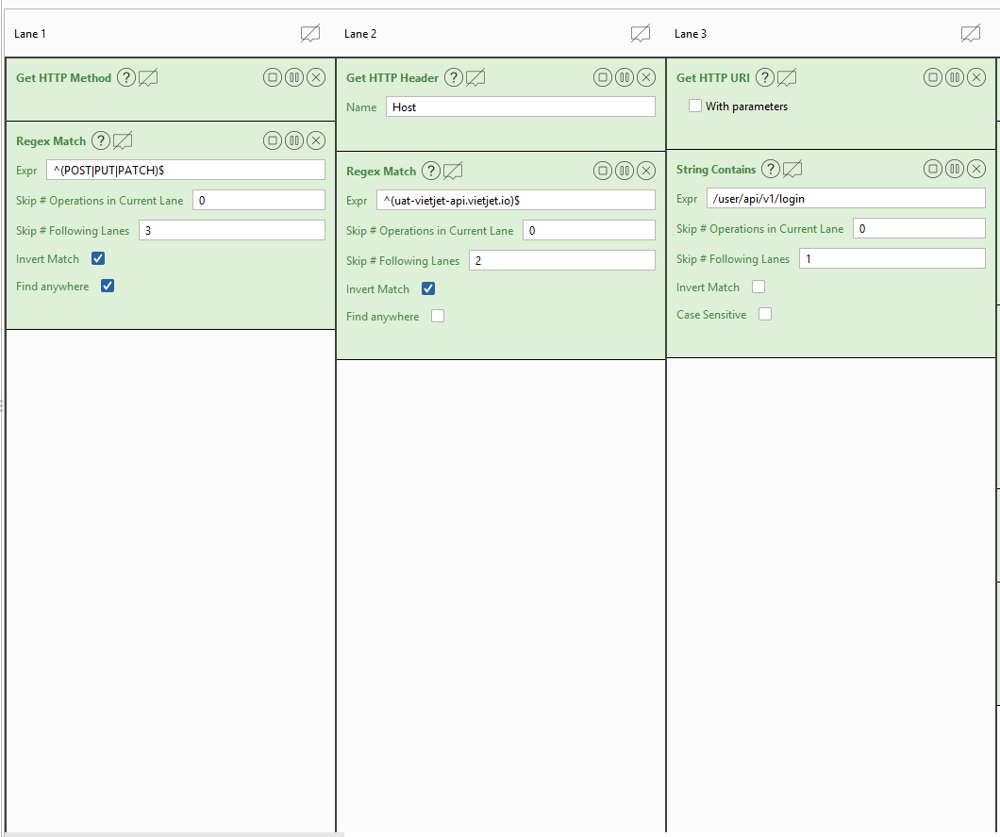
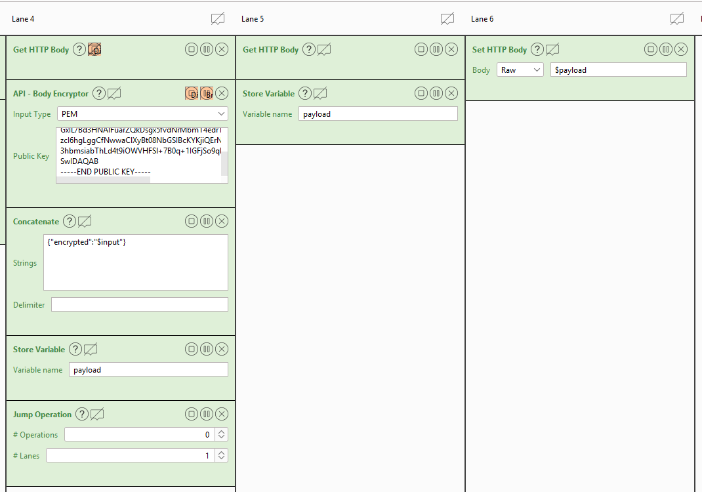
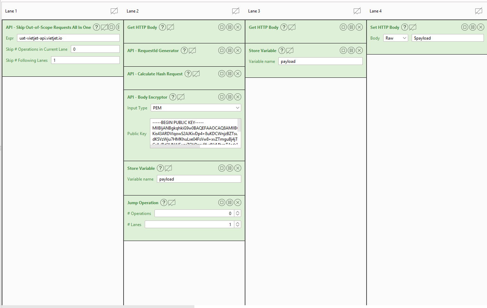

## Class GalaxyOneCSTC extends CSTC {
### Giải thích phần custom xử lý mã hóa body cho VJAPI

Flow dưới đây bao gồm 6 lanes mô tả quá trình hoạt động của tool như sau:

    
   
   
#### #Lane 1:
Kiểm tra HTTP Method của input request có nằm trong list method để cần thiết mã hóa hay không? Vì một request cần thiết được mã hóa chỉ khi có chứa request body như POST, PUT, PATCH. Nếu không phải thì bỏ qua việc xử lý của 3 lanes tiếp theo để nhảy đến lane thứ 5. 

#### #Lane 2:
Kiểm tra domain có phải là domain của VJAPI cần được mã hóa body hay không? Nếu không phải thì bỏ qua việc xử lý của 2 lanes tiếp theo để nhảy đến lane thứ 5.

#### #Lane 3:
Kiểm tra request url có phải là user api không? Một user api thì có chứa "/user/api/v1" prefix, vì endpoint này body không cần được encrypt nên sẽ bỏ qua. Nếu đúng thì bỏ qua việc xử lý của 1 lane tiếp theo để nhảy đến lane thứ 5.

#### #Lane 4:
Thực hiện lấy request body để encrypt với server public key của Vietjet, output được tạo ra sẽ được construct thành chuỗi json body mới dạng `{"encrypted":"<encrypted_data"}`. Cuối cùng kết quả của các operation trên lưu vào biến $payload và bỏ qua xử lý của lane tiếp theo để nhảy đến lane thứ 6.

#### #Lane 5:
Lane này chủ yếu là xử lý cho những trường hợp không cần mã hóa là chỉ việc set lại request body như cũ vào biến $payload.

#### #Lane 6:
Lane cuối cùng, thực hiện tạo lại một HTTP request hoàn chỉnh với body được lấy từ biến $payload.

### Tối ưu các lane filter out-of-scope request
Ở đây có hỗ trợ "Skip Out-of-Scope Requests All In One" operator để gộp 3 lanes đầu lại với nhau để tiện hơn trong việc setup config cho pentest.

Trong đó, chỉ cần một input là domain muốn thực hiện mã hóa body.

### Phân tích luồng mã hóa request body (cho cả case cần modify request)  

1. Lấy request body và public key của server là các input đầu vào
2. Load request body thành một json object 
3. Thực hiện generate giá trị `requestId` mới và gán lại cho object 
4. Xóa field `_signature` đi, vì đối với case modify lại body thì phải tính lại signature. Việc tính lại signature như sau:
   - Sort các key của body json object theo thứ tự alpahbet (A-Z)
   - Convert json object sang dạng url query (k1=v1&k2=v2) kiểu string
   - Hash SHA256 của query string từ output bước trên để có hash
5. Gán lại giá trị hash vừa tính cho field "_signature" của object
6. Dump json object ra string và đem đi mã hóa với public key. Lưu ý: Do server đang chạy Javascript nên custom lại json một số trường: `None -> rỗng`
7. Gán lại body rồi forward request đi và nhận response.

### TODO
- Thêm operator để detect request đến từ Repeater Tab mục đích giảm nhẹ việc phải đổi requestId và tính lại hash cho tất cả các request đi qua Proxy Tab. 

### }